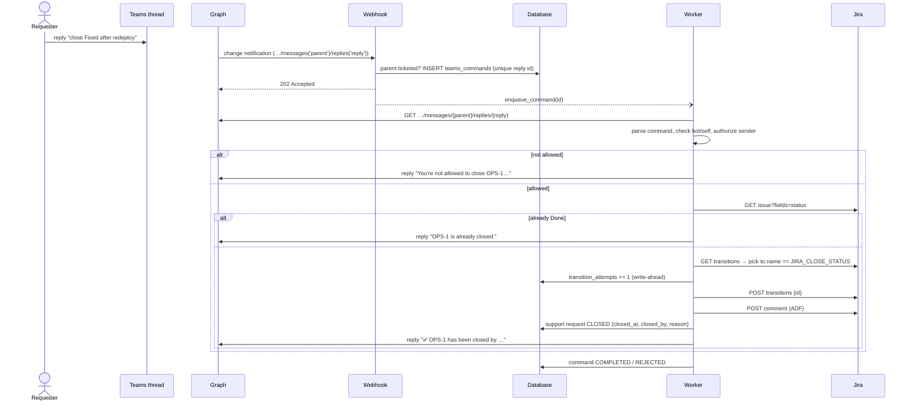
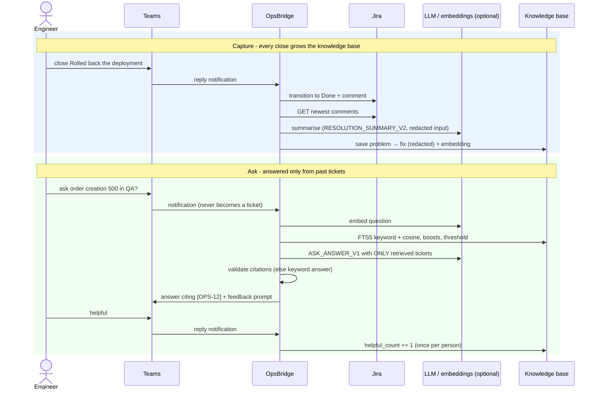
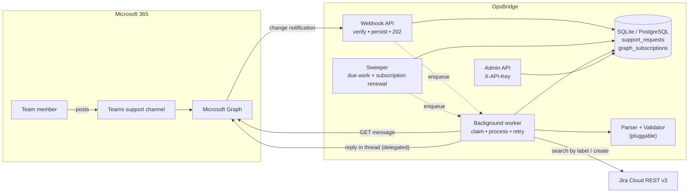
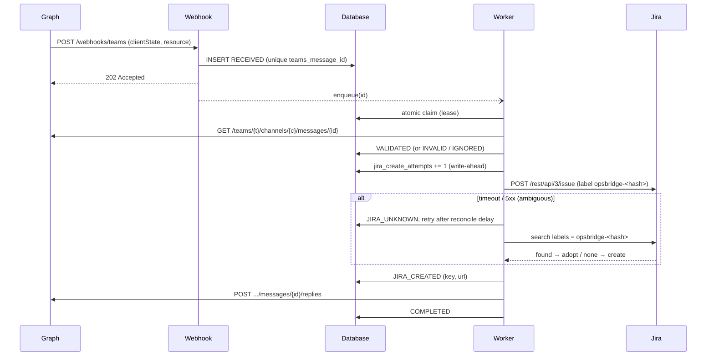

# OpsBridge

**Enterprise support-request automation: Microsoft Teams → Jira, with no manual triage.**

OpsBridge watches a dedicated Microsoft Teams support channel. It turns each structured request into a Jira issue
and replies in the original thread with the ticket link. Every step is persisted, idempotent and auditable.

> Proof of concept. It runs fully offline in **mock mode**: no Microsoft or Jira credentials are needed to try it.

---

## Contents

[Problem](#problem-statement) · [Workflow](#core-workflow) · [Architecture](#architecture) · [Tech stack](#technology-stack) ·
[Structure](#project-structure) · [Quick start](#quick-start-mock-mode) · [Configuration](#configuration) ·
[API](#api-documentation) · [Testing](#testing) · [Live setup](#connecting-real-teams-and-jira) ·
[Security](#security-considerations) · [Limitations](#current-limitations) · [Roadmap](#future-roadmap)

## Problem statement

In many engineering organisations:

* Support requests arrive as chat messages in Microsoft Teams.
* Someone forwards them to developers by hand, and engineers create Jira tickets by hand.
* Ownership is unclear and there is no central tracking.
* Follow-ups and status updates take manual effort.

OpsBridge makes the intake step automatic and traceable. A message posted in the channel becomes a Jira issue
within seconds, and the requester gets the ticket link in the same thread.

## Core workflow

1. A team member posts the intake template in the support channel:

   ```text
   API Name: CustomerOrderAPI
   Environment: QA
   Issue Summary: Order creation is failing
   Issue Description:
   The API returns HTTP 500 when creating an order.
   This started after the latest deployment.
   Correlation ID: CORR-123456
   Business Impact: Order processing is blocked in QA.
   Priority: P2
   ```

2. Microsoft Graph sends a change notification to `POST /webhooks/teams`.
3. OpsBridge verifies `clientState`, checks the team and channel, **persists the notification with a unique message ID**
   and returns `202` within milliseconds.
4. A background worker fetches the full message from Graph and ignores replies, bot posts and its own posts.
5. It parses and validates the template (required fields; `PROD`/`UAT`/`QA`; `P1`–`P3`).
6. It creates the Jira issue, using reconcile-before-create so a ticket is never duplicated.
7. It stores the Jira key and URL and replies in the Teams thread:

   ```text
   Your support request has been successfully registered.

   Jira Ticket: OPS-123
   Priority: P2
   Environment: QA
   Status: Created

   Our engineering team can now track this request.

   Thank you for using OpsBridge.
   ```

An incomplete submission gets a reply that lists every problem and shows the expected template. **No ticket is created for it.**

### Thread commands

After the ticket is created, people manage it by **replying in the original request thread**. They don't need to
open Jira. Commands are case-insensitive, may start with `/`, and must be the first word of the reply.

| Command | Who can run it | What happens |
|---|---|---|
| `status` | Anyone | Replies with the Jira status, assignee, priority and last update time. Changes nothing |
| `close [reason]` | Requester or support admin | Transitions the issue to `JIRA_CLOSE_STATUS`, adds a Jira comment and replies. The request becomes `CLOSED` |
| `reopen [reason]` | Requester or support admin | Only works on a closed ticket. Transitions it to `JIRA_REOPEN_STATUS`, comments, replies. The request goes back to `COMPLETED` |
| `escalate P1\|P2\|P3 [reason]` | Requester or support admin | **Raises** the priority (never lowers it): sets the Jira priority, adds the `escalated` label and a comment, **posts an alert in the escalation channel**, and replies |
| `ask <question>` | Anyone | Searches past resolved tickets and answers in the thread, citing them. Also works as a new channel message. Never creates a ticket ([details](#ai-assisted-self-service-ask)) |
| `helpful` / `not helpful` | Anyone (once each) | Rates an `ask` answer. This adjusts how those past fixes rank in future answers |

*Support admins* are the Entra object IDs in `TEAMS_COMMAND_ADMIN_USER_IDS`. Anyone else who tries a write command gets
*"You're not allowed to {close|reopen|escalate} OPS-1. Only the requester or a support admin can."*, and Jira is not touched.

Example replies:

```text
📋 OPS-1 status: In Progress
Assignee: Jane Engineer
Priority: High
Last updated: 2026-11-15 10:22 UTC

🚨 OPS-1 has been escalated from P2 to P1 by Sample User.
Reason: Customer-facing outage
The escalation channel has been notified.

🔄 OPS-1 has been reopened by Sample User.
Reason: still failing after deploy
```

Refusals, where nothing changes and the user is told why: `reopen` on a ticket that isn't closed; `escalate` to a priority
that isn't higher; `escalate` on a closed ticket (reopen it first); `escalate` without a valid priority (shows usage);
a workflow with no transition to the target status.

#### Close in detail

```text
close Fixed after redeploy
```

`/close` works too, and everything after the command is an optional reason. OpsBridge then:

1. **Checks who is asking.** Only the original requester, or a support admin, may close.
   Anyone else gets *"You're not allowed to close OPS-1. Only the requester or a support admin can."*, and Jira is not touched.
2. **Closes the Jira issue.** It finds the workflow transition whose target status is `JIRA_CLOSE_STATUS` (default `Done`),
   applies it, and adds the comment *"Closed from Microsoft Teams by Sample User. Reason: Fixed after redeploy"*.
3. **Replies in the thread:**

   ```text
   ✅ OPS-1 has been closed by Sample User.
   Reason: Fixed after redeploy
   Jira: https://your-site.atlassian.net/browse/OPS-1
   ```

4. **Records it.** The request's status becomes `CLOSED`, with who closed it, when and why.

Other cases:

| Case | Result |
|---|---|
| The ticket is already closed | Reply *"OPS-1 is already closed."* Nothing changes |
| The workflow has no transition to the close status | Reply explaining why. The issue is left untouched |
| Any other reply (`thanks!`, `closed the browser…`) | Ignored, as before |
| Bot posts, OpsBridge's own posts, replies in unknown threads | Ignored |
| The same reply notification delivered several times | Executed once (unique Teams reply ID) |



Each step is saved before the next one starts. Transient failures, including 429 responses with `Retry-After`, retry
with the same exponential backoff as ticket creation. A timeout after the transition, the comment or the Teams reply
never repeats that step: the retry first checks Jira's status, the existing comments, or the thread.

### Jira → Teams updates

When someone changes a ticket's **status** or **assignee** in Jira, the requester sees it in the same Teams thread.
They don't need to watch Jira:

```text
🔔 OPS-1 was updated in Jira
Status: To Do → In Progress
Assignee: Unassigned → Jane Engineer
Jira: https://your-site.atlassian.net/browse/OPS-1
```

* **Polling (default, zero setup).** Every 2 minutes OpsBridge asks Jira which project issues changed recently.
  **Optional webhook** (`POST /webhooks/jira`, signed with `JIRA_WEBHOOK_SECRET`) makes it near-instant. See
  [docs/jira-setup.md](docs/jira-setup.md#jira--teams-status-sync).
* **Each change is posted exactly once**, even when the poll and the webhook both see it, a webhook is redelivered,
  or events arrive out of order. Comment, label and priority edits are not posted.
* **No echo.** A `close`/`reopen` from Teams has already replied, so its status change isn't posted again.
* **Stays in step.** Closing the issue in Jira marks the request `CLOSED`, and reopening it in Jira sets it back to `COMPLETED`.

### AI-assisted self-service (`ask`)

Before filing a ticket, anyone can ask whether this has happened before. OpsBridge answers **only from past
resolved tickets** and cites them. The knowledge base fills itself: every closed ticket becomes a
"problem → fix" entry.

**Example conversation (support channel):**

```text
Priya:      ask CustomerOrderAPI returns HTTP 500 on order creation in QA after a deploy - known fix?

OpsBridge:  This matches [OPS-12] (QA): the new build broke order validation; rolling back the
            order-service deployment fixed it. A similar issue in PROD [OPS-31] was fixed the same way.
            Reply `helpful` or `not helpful`. Still stuck? Post a support request and a ticket will be created.

Priya:      helpful
OpsBridge:  👍 Thanks! Your feedback helps OpsBridge rank the most useful fixes first.
```

`ask` works as a new channel message or as a reply in any request or answer thread. It **never** creates a Jira
ticket. With nothing relevant (`ASK_MIN_SCORE`), the answer is *"I couldn't find a similar resolved issue. Please
post a support request using the template."* together with the template.

**How it works**

| Step | What happens |
|---|---|
| **Capture** (on every close) | Close reason + newest human Jira comments → optional LLM summary (`RESOLUTION_SUMMARY_V2`: 2–4 sentences, the fix plus the root cause if stated, no speculation. The model replies `NO_RESOLUTION` when the notes contain no actual fix, and the ticket is skipped) → **redacted** → saved → embedded. Tickets closed directly in Jira are captured by a background sweep. Closes with no meaningful text (`close`, `close fixed`) are skipped, and the close reply suggests adding a reason next time |
| **Retrieve** | Hybrid search: SQLite FTS5 keyword (BM25 + term coverage) and embedding cosine, blended 0.6 / 0.4, plus boosts for same API (+0.15), environment, HTTP code, recency and helpful feedback, and a penalty for not-helpful feedback. Top `ASK_TOP_K` above `ASK_MIN_SCORE` |
| **Answer** | LLM on and within budget: `ASK_ANSWER_V1` sees **only** the retrieved tickets, and every Jira key it cites must be one of them, otherwise the answer is discarded. Otherwise, or on any LLM problem, a formatted list of the past fixes (key + link, environment, date, problem, fix) |
| **Learn** | `helpful` / `not helpful` replies, once per person, adjust the ranking of the cited fixes. The asker's verdict feeds the deflection metric |



**LLM providers** (chat and embeddings are configured separately; everything works with `LLM_ENABLED=false`):

| Provider | Chat | Embeddings | Notes |
|---|---|---|---|
| `anthropic` | ✅ Claude (default `claude-opus-5-5`) | – | Needs `LLM_API_KEY`. Pair it with `EMBEDDING_PROVIDER=openai`, `ollama` or `mock` |
| `openai` | ✅ (default `gpt-4o-mini`) | ✅ (`text-embedding-3-small`) | Needs `LLM_API_KEY` / `EMBEDDING_API_KEY` |
| `ollama` | ✅ (default `llama3.1`) | ✅ (`nomic-embed-text`) | **Free and local**, no data leaves your machine |
| `mock` | ✅ deterministic | ✅ word-hashing vectors | Default. Offline, used in tests and demos |

Free local setup with Ollama:

```bash
ollama pull llama3.1
ollama pull nomic-embed-text
# .env
LLM_ENABLED=true
LLM_PROVIDER=ollama
EMBEDDING_PROVIDER=ollama
OLLAMA_BASE_URL=http://host.docker.internal:11434   # Ollama on the host, OpsBridge in Docker
docker compose up -d --force-recreate
docker compose exec opsbridge python scripts/backfill_knowledge.py   # (re)embed existing entries
```

**Privacy and safety**
* **Redaction before storage and before every LLM call:** emails, bearer tokens and JWTs, `password=` /
  `api_key:` style secrets, known key prefixes, long hex or base64 strings, and phone numbers. Jira keys, correlation IDs,
  HTTP codes and dates are kept because they're useful for search.
* **Grounding rule:** answers come only from past tickets, and citations are checked mechanically. An answer that cites
  something that wasn't retrieved is never shown.
* **Cost control:** `LLM_DAILY_TOKEN_BUDGET` counts chat and embedding tokens per UTC day, stored in the database so a
  restart doesn't reset it. When the budget runs out, answers continue in keyword mode. Every call is logged with provider,
  model, tokens and latency, never prompt text.
* **Resilience:** timeouts, retries with backoff for 429 and 5xx, and any LLM failure falls back to the non-LLM answer.
  A `close` never fails because of the LLM.

Design rationale (hybrid search, grounding, FTS5, the PostgreSQL + pgvector path): [docs/design-decisions.md](docs/design-decisions.md).

## Architecture





The state machine, concurrency model, idempotency guarantees and background-processing trade-offs are explained in
**[docs/architecture.md](docs/architecture.md)**.

### Key design decisions

| Concern | Decision |
|---|---|
| Fast webhook acknowledgement | The webhook only verifies, inserts a row and returns 202. The database row is the durable unit of work |
| Duplicate notifications | Unique index on `teams_message_id`. A collision means "already have it" |
| Concurrent workers | Atomic conditional `UPDATE` claim with a lease (`locked_until`). Works on SQLite and PostgreSQL |
| Duplicate Jira tickets | Deterministic label `opsbridge-<hash>`, a write-ahead attempt counter, and a label search **before** any re-create |
| Ambiguous failures | Error taxonomy: Transient (safe to resend), Ambiguous (reconcile first), Permanent (fail fast) |
| Duplicate Teams replies | A reference marker in each reply. After an ambiguous reply, the thread is checked before re-sending |
| Retries | In-call retries for transient HTTP errors, plus job-level exponential backoff with jitter, then `FAILED` and manual retry |
| Extensibility | `RequestParser` protocol (template now, LLM later), `GraphClient`/`JiraClient` protocols, a single composition root |
| Teams replies | A delegated service account, because Graph has no app-only permission for posting channel messages |

## Technology stack

| Layer | Technology |
|---|---|
| Runtime | Python 3.12 |
| API | FastAPI, Uvicorn |
| Validation and config | Pydantic v2, pydantic-settings |
| Persistence | SQLAlchemy 2.0 (SQLite now; PostgreSQL-ready) |
| HTTP | HTTPX (sync clients, `MockTransport` in tests) |
| Integrations | Microsoft Graph v1.0, Microsoft Entra ID OAuth 2.0, Jira Cloud REST API v3 |
| Testing | Pytest |
| Ops | Docker, Docker Compose, ngrok, stdlib `logging` with JSON output |

## Project structure

```text
opsbridge/
├── app/
│   ├── main.py                  # FastAPI factory, lifespan, routers
│   ├── config.py                # Settings from env / .env
│   ├── container.py             # Composition root: real vs mock integrations
│   ├── api/
│   │   ├── health.py            # GET /health
│   │   ├── webhooks.py          # Graph notifications + lifecycle + validation
│   │   ├── subscriptions.py     # create / renew / list subscriptions
│   │   ├── support_requests.py  # list / detail / retry
│   │   └── dev.py               # mock-mode simulation endpoints
│   ├── core/                    # logging, trace ids, errors, retry math, security, text
│   ├── domain/                  # pure types: InboundMessage, SupportRequestDraft, enums
│   ├── integrations/
│   │   ├── http.py              # error classification + bounded retries
│   │   ├── microsoft_graph.py   # tokens, messages, replies, subscriptions (+ mock)
│   │   └── jira_client.py       # create + search-by-label (+ mock)
│   ├── services/
│   │   ├── ingestion_service.py      # webhook-side: verify, filter, persist, enqueue
│   │   ├── command_parser.py         # reply text -> Command: close, reopen, status, escalate
│   │   ├── command_handler.py        # thread commands: intake, authorization, execution
│   │   ├── jira_sync_service.py      # Jira -> Teams: change detection (poll + webhook), thread updates
│   │   ├── knowledge_service.py      # close -> knowledge entry (summary, redaction, embedding)
│   │   ├── knowledge_search.py       # hybrid FTS5 + embedding retrieval with boosts
│   │   ├── ask_service.py            # `ask`: grounded answers, citation validation, feedback, metrics
│   │   ├── message_processor.py      # state machine, idempotency, retries
│   │   ├── request_parser.py         # RequestParser protocol + template parser
│   │   ├── request_validator.py      # business rules
│   │   ├── intake_template.py        # single source of truth for the template
│   │   ├── jira_service.py           # issue payload (ADF), labels, priority mapping
│   │   ├── notification_service.py   # Teams replies
│   │   ├── subscription_service.py   # Graph subscription lifecycle
│   │   └── support_request_service.py# admin queries + safe manual retry
│   ├── llm/                     # provider-neutral LLM layer: base, anthropic/openai/ollama/mock, gateway, redaction, prompts/
│   ├── models/                  # SupportRequest, TeamsCommand, TeamsNotification, KnowledgeEntry, AskQuery, GraphSubscription
│   ├── repositories/            # all SQL: idempotent inserts, shared lease/claim helpers, queries
│   ├── schemas/                 # API + Graph payload schemas
│   ├── workers/background.py    # thread pool + sweeper
│   └── database/                # engine/session, UTC datetime type, additive migrations
├── tests/                       # 299 tests, all external calls mocked
├── scripts/                     # init_db, simulate_teams_message, get_delegated_token
├── docs/                        # architecture, Microsoft setup, Jira setup
├── Dockerfile · docker-compose.yml · .env.example · requirements*.txt
```

`app/domain`, `app/core`, `app/schemas` and `app/workers` were added to the suggested layout. They keep pure types,
cross-cutting concerns, wire formats and execution strategy apart from the business services.

## Quick start (mock mode)

The default configuration runs with **no credentials**. Graph and Jira are replaced by in-memory mocks that
behave like the real APIs and can inject failures.

### Docker (recommended)

Only Docker is required. You don't need Python on the host.

```bash
cd opsbridge
cp .env.example .env                 # optional; without it the app runs in mock mode
docker compose up -d --build         # API on http://localhost:8080
docker compose ps                    # STATUS should show (healthy)
docker compose logs -f opsbridge     # JSON logs
```

Open <http://localhost:8080/docs>, click **Authorize** and enter `dev-admin-key`.
The host port defaults to **8080** and can be changed: `OPSBRIDGE_PORT=9000 docker compose up -d`.
The SQLite database lives in the named volume `opsbridge-data`, so it survives restarts and rebuilds.
In mock mode, the mock Jira issues and Teams replies are kept in memory and reset when the container restarts.

| Task | Command |
|---|---|
| Run the test suite in a container | `docker compose --profile test run --rm tests` |
| Rebuild after code changes | `docker compose up -d --build` |
| Stop | `docker compose down` |
| Stop and delete the database | `docker compose down -v` |
| Public tunnel for real Graph webhooks | `NGROK_AUTHTOKEN=... docker compose --profile tunnel up -d` |

### Try it

The helper scripts run inside the running container:

```bash
docker compose exec opsbridge python scripts/simulate_teams_message.py                 # valid -> COMPLETED + OPS-1
docker compose exec opsbridge python scripts/simulate_teams_message.py --invalid       # REJECTED, reply lists problems
docker compose exec opsbridge python scripts/simulate_teams_message.py --duplicates 3  # 3 deliveries -> one ticket
```

Inject failures to watch retries and reconciliation:

```bash
curl -X POST localhost:8080/dev/fail-next -H "X-API-Key: dev-admin-key" \
     -H "Content-Type: application/json" -d '{"target": "jira", "modes": ["ambiguous_after"]}'
docker compose exec opsbridge python scripts/simulate_teams_message.py   # -> JIRA_UNKNOWN, then reconciled
```

### Without Docker (optional)

```bash
python -m venv .venv && source .venv/bin/activate     # Windows: .venv\Scripts\activate
pip install -r requirements-dev.txt
uvicorn app.main:create_app --factory --reload         # http://localhost:8000
pytest
```

Jira modes: `transient`, `ambiguous_lost`, `ambiguous_after`, `permanent`, `search_transient`.
Graph modes: `get_transient`, `get_not_found`, `reply_transient`, `reply_ambiguous_after`, `reply_permanent`.

## Configuration

All configuration comes from environment variables, or from `.env` (see [`.env.example`](.env.example)).
Nothing tenant-specific is hard-coded: project key, issue type and priority names are all configurable.

| Variable | Default | Purpose |
|---|---|---|
| `APP_ENV` | `development` | `production` enforces a strong `ADMIN_API_KEY` and `MOCK_MODE=false`, and disables `/docs` |
| `APP_BASE_URL` | – | Public HTTPS URL Graph calls (e.g. the ngrok URL) |
| `ADMIN_API_KEY` | `dev-admin-key` | `X-API-Key` for admin endpoints |
| `MOCK_MODE` | `true` | In-memory Graph and Jira. `false` requires all live settings, and startup lists the missing ones **by name only** |
| `MICROSOFT_TENANT_ID` / `_CLIENT_ID` / `_CLIENT_SECRET` | – | App registration (client credentials) |
| `MICROSOFT_CLIENT_STATE` | – | Shared secret Graph echoes in each notification |
| `MICROSOFT_DELEGATED_REFRESH_TOKEN` | – | Service-account token for posting replies |
| `MICROSOFT_SERVICE_ACCOUNT_USER_ID` | – | Service account object ID (its posts are ignored) |
| `TEAMS_TEAM_ID` / `TEAMS_CHANNEL_ID` | – | The single support channel to process |
| `TEAMS_COMMAND_ADMIN_USER_IDS` | – | Comma-separated Entra object IDs of support admins who may `close`, `reopen` and `escalate` any request. The requester can always run them on their own request. `TEAMS_CLOSE_ALLOWED_USER_IDS` (older name) is merged in |
| `TEAMS_ESCALATION_CHANNEL_ID` | – | Channel (same team, **not** the support channel) where `escalate` posts an alert. Empty = no alert |
| `JIRA_CLOSE_STATUS` / `JIRA_REOPEN_STATUS` | `Done` / `To Do` | Target statuses for `close` and `reopen`. Matched case-insensitively against each transition's `to.name` |
| `JIRA_ESCALATION_LABEL` | `escalated` | Label added by `escalate` |
| `JIRA_SYNC_ENABLED` | `true` | Post Jira status/assignee changes in the request thread |
| `JIRA_SYNC_POLL_INTERVAL_SECONDS` | `120` | How often to poll Jira for changes. `0` = webhook only |
| `JIRA_WEBHOOK_SECRET` | – | Enables `POST /webhooks/jira` (HMAC `X-Hub-Signature` or `?secret=`). Empty = disabled |
| `LLM_ENABLED` | `false` | Use an LLM for resolution summaries and `ask` answers. Off = deterministic answers |
| `LLM_PROVIDER` / `LLM_MODEL` / `LLM_API_KEY` | `mock` / provider default / – | `anthropic`, `openai`, `ollama` or `mock` |
| `EMBEDDING_PROVIDER` / `EMBEDDING_MODEL` / `EMBEDDING_API_KEY` | `mock` / provider default / – | `openai`, `ollama`, `mock` or `none` (keyword search only) |
| `OLLAMA_BASE_URL` | `http://localhost:11434` | Local Ollama server (`http://host.docker.internal:11434` from Docker) |
| `LLM_TIMEOUT_SECONDS` / `LLM_DAILY_TOKEN_BUDGET` | `30` / `200000` | Per-call timeout. Tokens per UTC day (chat + embeddings, `0` = unlimited) |
| `ASK_MIN_SCORE` / `ASK_TOP_K` | `0.35` / `3` | Relevance threshold (0–1) and number of past fixes used per answer |
| `GRAPH_SUBSCRIPTION_LIFETIME_MINUTES` | `4200` | ≤ 4230 (Graph max is ~3 days for chat messages) |
| `GRAPH_SUBSCRIPTION_RENEWAL_THRESHOLD_MINUTES` | `720` | Renew when expiry is closer than this |
| `JIRA_BASE_URL` / `JIRA_EMAIL` / `JIRA_API_TOKEN` | – | Jira Cloud basic auth (API token) |
| `JIRA_PROJECT_KEY` / `JIRA_ISSUE_TYPE` | `OPS` / `Task` | Target project and issue type name |
| `JIRA_PRIORITY_MAP` | `{"P1":"Highest","P2":"High","P3":"Medium"}` | JSON, mapping to Jira priority names. `{}` = don't set |
| `JIRA_EXTRA_LABELS` | `opsbridge` | Comma-separated or JSON list |
| `JIRA_RECONCILE_DELAY_SECONDS` | `60` | Minimum wait before searching after an ambiguous create |
| `DATABASE_URL` | `sqlite:///./opsbridge.db` | Any SQLAlchemy URL (e.g. `postgresql+psycopg://...`, add the driver) |
| `WORKER_COUNT` | `2` | Worker threads |
| `WORKER_POLL_INTERVAL_SECONDS` | `10` | Sweeper interval for due or orphaned work |
| `MAX_RETRIES` | `5` | Job-level retries per stage before `FAILED` |
| `RETRY_BASE_DELAY_SECONDS` / `RETRY_MAX_DELAY_SECONDS` | `5` / `900` | Exponential backoff (±20% jitter) |
| `HTTP_TIMEOUT_SECONDS` / `HTTP_MAX_ATTEMPTS` | `10` / `3` | Per-call timeout and in-call retries |
| `LOG_LEVEL` / `LOG_FORMAT` | `INFO` / `json` | `text` for human-readable local logs |

## API documentation

Interactive OpenAPI docs are at `/docs` (except in production). Admin endpoints require `X-API-Key`.

| Method | Path | Auth | Description |
|---|---|---|---|
| `GET` | `/health` | public | `200 ok` or `503 degraded`, with database and worker checks |
| `POST` | `/webhooks/teams` | `clientState` | Graph change notifications. Echoes `?validationToken=` as `text/plain` |
| `POST` | `/webhooks/teams/lifecycle` | `clientState` | `reauthorizationRequired`, `subscriptionRemoved`, `missed` |
| `POST` | `/webhooks/jira` | `JIRA_WEBHOOK_SECRET` | Jira issue webhooks → status/assignee change posted in the Teams thread. `404` if not configured |
| `GET` | `/subscriptions` | admin | Known subscriptions |
| `POST` | `/subscriptions/create` | admin | Body `{"force": false}`. Returns `201` if created, `200` if an active one exists |
| `POST` | `/subscriptions/renew` | admin | Body `{"subscription_id": null}` renews all. A missing subscription is recreated |
| `GET` | `/support-requests` | admin | `?status=FAILED&limit=20&offset=0`, newest first, `{items,total,limit,offset}` |
| `GET` | `/support-requests/{id}` | admin | Full detail: fields, validation errors, Jira, acknowledgement, close/escalation details, last Jira status and assignee, thread `commands` and `notifications`, trace ID |
| `POST` | `/support-requests/{id}/retry` | admin | `202`. Resumes a `FAILED` request at the right stage. `409` if completed, closed or currently processing |
| `POST` | `/dev/simulate-message` | admin, mock only | Feeds a Graph-shaped message and notification through the real ingestion path |
| `GET` | `/knowledge` | admin | Knowledge entries, `?api_name=&environment=&limit=&offset=` |
| `GET` / `DELETE` | `/knowledge/{id}` | admin | One entry. `DELETE` removes a wrong or outdated fix (also from search) |
| `GET` | `/ask-queries` | admin | Questions asked, with mode (`llm`/`keyword`/`none`), sources, score, answer and feedback |
| `GET` | `/metrics/deflection` | admin | Total asks, answered %, helpful %, **tickets avoided** (helpful answer, and no support request from the same person for the same API within 24 h) |
| `POST` | `/dev/jira-change` | admin, mock only | Simulate a status/assignee change in mock Jira, then run the sync poll |
| `GET` | `/dev/mock-state` | admin, mock only | Mock Jira issues, Teams replies and subscriptions |
| `POST` | `/dev/fail-next` | admin, mock only | Queue failure modes on the mock clients |

Every response carries `X-Request-ID`. An incoming `X-Request-ID` is honoured if it is safe, otherwise one is generated.

**Processing statuses:** `RECEIVED` → `VALIDATED` → (`JIRA_UNKNOWN`) → `JIRA_CREATED` → `COMPLETED` ⇄ `CLOSED`
(`close` / `reopen`); `INVALID` → `REJECTED`; `IGNORED`; `FAILED`.

**Command statuses** (one row per command reply, listed under `commands` in the detail response, with `details`):
`RECEIVED` → `EXECUTING` → `REPLYING` → `COMPLETED` (outcomes `CLOSED`, `ALREADY_CLOSED`, `REOPENED`,
`STATUS_REPORTED`, `ESCALATED`) or `REJECTED` (outcomes `UNAUTHORIZED`, `NO_TRANSITION`, `NOT_CLOSED`, `NOT_HIGHER`,
`TICKET_CLOSED`, `INVALID_ARGS`); `IGNORED` (not a command, bot or self); `FAILED` (with `error_message`).

```bash
curl -s localhost:8080/support-requests/1 -H "X-API-Key: dev-admin-key"
```

```json
{
  "id": 1,
  "processing_status": "COMPLETED",
  "api_name": "CustomerOrderAPI",
  "environment": "QA",
  "priority": "P2",
  "jira_issue_key": "OPS-1",
  "jira_issue_url": "https://mock-jira.example.com/browse/OPS-1",
  "jira_create_attempts": 1,
  "acknowledged_at": "2026-01-01T10:00:01Z",
  "retry_count": 0,
  "error_message": null,
  "trace_id": "64643107f7fd443a829bcf6b0dd54372"
}
```

## Testing

```bash
docker compose --profile test run --rm tests    # 299 tests, no network access (or: pytest, outside Docker)
```

| Scenario | Where |
|---|---|
| Valid Teams message → Jira → acknowledgement | `test_processing.py::test_valid_message_creates_issue_and_acknowledges` |
| Missing required fields | `test_request_parsing.py`, `test_processing.py::test_invalid_submission_*` |
| Invalid priority / environment | `test_request_parsing.py::test_invalid_priority`, `::test_invalid_environment` |
| Duplicate Teams notifications | `test_webhooks.py::test_redelivered_*`, `test_processing.py::test_duplicate_*` |
| Jira success / failure (transient, permanent, priority fallback) | `test_processing.py`, `test_http_clients.py` |
| Microsoft Graph failure | `test_processing.py::test_graph_*`, `test_http_clients.py::test_graph_*` |
| Teams acknowledgement failure (transient, ambiguous, permanent) | `test_processing.py::test_ack_*` |
| Retry behaviour, backoff, exhaustion, manual retry | `test_processing.py::test_*retr*`, `test_api.py::test_retry_*` |
| Ambiguous Jira timeout and reconciliation | `test_processing.py::test_ambiguous_*`, `::test_reconciliation_*` |
| Webhook validation (token, clientState, payload, lifecycle) | `test_webhooks.py` |
| Concurrent workers racing on one request | `test_processing.py::test_concurrent_workers_process_a_request_once` |
| Secret redaction and config safety | `test_config_and_logging.py` |
| Close from Teams: requester, admin, unauthorized, already Done, no transition, retries, duplicates, ambiguous timeouts | `test_close_command.py` |
| Command parsing (`close`, `/close`, `CLOSE reason`, `closed` not matching, `escalate` arguments, whitespace) | `test_command_parser.py` |
| `status`, `reopen`, `escalate`: permissions, refusals, escalation alert, priority fallback, retries, ambiguity, duplicates | `test_more_commands.py` |
| Jira → Teams sync: polling, webhook signature, duplicates, out-of-order, no echo, closed/reopened in Jira, concurrency, delivery retries | `test_jira_sync.py` |
| LLM layer: redaction, provider HTTP shapes, budget, usage logging, failure → fallback | `test_llm.py` |
| Knowledge capture: on close, LLM summary, skip rules, redaction, embeddings, FTS sync, sweep, backfill | `test_knowledge.py` |
| `ask`: hybrid ranking, threshold, citation validation, LLM failure/budget fallback, no tickets, idempotency, feedback, metrics, API | `test_ask.py` |
| Additive schema migration of an existing database | `test_close_command.py::test_additive_migration_upgrades_an_old_database` |

The real HTTP clients are tested against `httpx.MockTransport` responses that imitate Jira, Graph and Entra ID, including
status codes, error bodies, timeouts and `Retry-After`. Service-level tests use the in-memory mock clients.

## Connecting real Teams and Jira

1. **Jira sandbox:** [docs/jira-setup.md](docs/jira-setup.md)
2. **Microsoft test tenant** (app registration, permissions, **admin consent**, service account): [docs/microsoft-setup.md](docs/microsoft-setup.md)
3. **Expose the webhook with ngrok:**

   ```bash
   NGROK_AUTHTOKEN=<token> docker compose --profile tunnel up -d   # public URL at http://localhost:4040
   # copy the https://<id>.ngrok-free.app URL
   ```

   Set `APP_BASE_URL=https://<id>.ngrok-free.app` and `MOCK_MODE=false`, then restart.
   Free ngrok URLs change on every restart. When yours changes, update `APP_BASE_URL` and call
   `POST /subscriptions/create` with `{"force": true}`.
4. **Create the subscription:**

   ```bash
   curl -X POST "$APP_BASE_URL/subscriptions/create" -H "X-API-Key: $ADMIN_API_KEY"
   ```

5. Post the template in the channel and watch the logs.

## Security considerations

* **Webhook authenticity:** `clientState` is compared in constant time, and the tenant ID is checked when configured.
  Only the configured team and channel are processed. Payload size is capped at 1 MB, and the validation token is echoed only
  as `text/plain`.
* **Admin API:** static API key in `X-API-Key`, compared in constant time. Production refuses to start with the default
  or a short key. `/docs` is off in production, and `/dev` exists only in mock mode.
* **Secrets:** stored as `SecretStr`, so they never appear in reprs. Config errors list **setting names only**. This is why
  cross-field checks are not Pydantic validators: Pydantic echoes input values in its errors. The code never logs
  credentials, and a log redaction filter masks bearer tokens, `client_secret`, `refresh_token` and `api_token` as a backstop.
  Request paths are logged without query strings.
* **Least privilege:** `ChannelMessage.Read.All` is tenant-wide, so prefer resource-specific consent for production.
  Use a dedicated service account for replies and a dedicated Jira user with only *Browse* and *Create* in one project.
* **AI data handling:** text is redacted before it's stored as knowledge or sent to an LLM provider. A daily token budget
  is enforced. Prompts are never logged. Answers are limited to retrieved tickets, with citations checked.
* **Injection:** user-supplied values are HTML-escaped in Teams replies, sent as ADF text nodes to Jira (not wiki
  markup), and JQL values are quoted and escaped.
* **Container:** runs as a non-root user. `.env` is excluded from git and from the Docker build context.
* **Credential lifecycle:** rotate the client secret before it expires. The delegated refresh token is a long-lived
  credential: keep it in a secret store (Key Vault or similar) in any real deployment.

## Current limitations

* **In-process worker.** Workers share the API process. The database is the durable queue, so restarts lose nothing,
  but throughput is bounded and there is no dedicated dead-letter tooling beyond `FAILED` rows and `/retry`.
  See [architecture.md §3.9](docs/architecture.md#39-background-processing-poc-limits-and-how-it-evolves).
* **SQLite** allows one writer at a time. It suits a POC, but use PostgreSQL for multiple replicas or higher volume.
  On startup, OpsBridge automatically *adds* new tables, columns and indexes to an existing database
  (`app/database/migrations.py`). Renames, type changes and drops need a real migration tool (Alembic).
* **Commands only in ticketed threads.** A command reply is considered only once the request has a Jira issue. A reply sent
  before the ticket exists is ignored. Every reply in a ticketed thread is fetched once, including OpsBridge's own,
  and stored as an `IGNORED` command row for auditability.
* **Reconciliation relies on Jira search.** If Jira's index lags longer than `JIRA_RECONCILE_DELAY_SECONDS` after an
  ambiguous create, a duplicate is possible, though unlikely. Raise the delay for more safety at the cost of latency.
* **Rotated refresh tokens** are kept in memory only. After a restart the configured token is used again, which still works
  until it expires. Store rotated tokens in a secret store for long-running deployments.
* **One channel** per deployment. **Template-only** intake (no free text yet). Edited messages are not re-processed.
* **Catch-up** after a `missed` lifecycle event scans only the 50 most recent channel messages.
* **The host must stay up for Teams intake.** Graph subscriptions last about 3 days and are renewed in the background. If
  OpsBridge or the ngrok tunnel is down past expiry (a laptop that was off over a weekend), new Teams messages stop
  arriving. `/health` then reports `teams_subscription: expired/none` with HTTP 503. Once the app and tunnel are back,
  the worker recreates the subscription automatically within 5 minutes, or run `POST /subscriptions/create`. Messages
  posted while it was down are not recovered.
* **Knowledge base is single-node.** Vectors are compared in Python and keyword search uses SQLite FTS5. That's fine
  for thousands of entries. Move to PostgreSQL + pgvector beyond that ([design decisions](docs/design-decisions.md#dd-4-migration-path-to-postgresql--pgvector)).
  Knowledge is only as good as close reasons and Jira comments, so encourage `close <what fixed it>`.
* **Jira sync posts net changes.** With polling, a status that changes and changes back between two polls
  (A → B → A) isn't posted. The webhook sees every change. Polling also can't say *who* made the change.
* **Admin auth** is a single shared API key. Production would use Entra ID (OAuth) with roles.

## Future roadmap

The architecture already has seams for these: a parser protocol, an integration protocol, a single composition root,
and processing state stored per request.

**Phase 2 – Workflow intelligence**
* Automatic developer assignment and API-ownership routing (an ownership table keyed by `api_name`, then a Jira assignee or component)
* Duplicate-incident detection (same API, environment and time window)
* `help` and `assign @person` thread commands, and an escalation flow that pages the on-call engineer
* Adaptive Card buttons (**Status**, **Close**, **Reopen**, **Escalate**) on the acknowledgement, through a Teams bot, so users can tap
  instead of typing commands
* SLA tracking per priority, a support-request dashboard and analytics (the `support_requests` table already holds the data)
* Durable broker (transactional outbox → Service Bus / RabbitMQ / SQS), PostgreSQL, Alembic, Entra-ID-protected admin API

**Phase 3 – AI-powered support** (foundation done: `app/llm/` gateway, providers, redaction, budget, versioned prompts;
`ask` self-service, knowledge capture and similar-issue lookup are implemented)
* Natural-language intake: an `LlmRequestParser` implementing `RequestParser`, plugged in at `container.py`, with the same
  validator guarding its output
* Suggest matching past fixes inside the "ticket created" reply, using the same `KnowledgeSearch`
* Priority recommendations, routing suggestions and AI-generated ticket summaries, as additional services that
  enrich `TicketRequest` before `JiraService` builds the payload

---

*All names, IDs and URLs in this repository are fictional sample data.*
