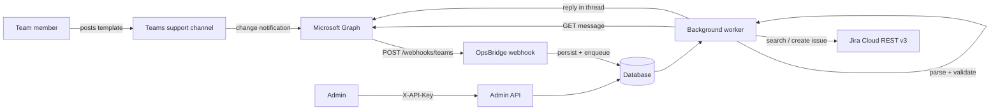
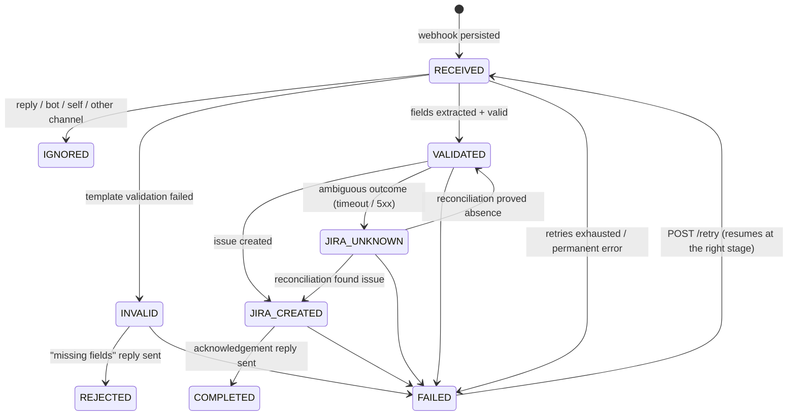

# OpsBridge Architecture

This document explains how OpsBridge is put together and why. The README covers setup and usage.

## 1. Context



## 2. Layering

| Layer | Package | Responsibility | May depend on |
|---|---|---|---|
| API | `app/api` | HTTP contracts, auth, request validation, fast acknowledgement | services, repositories, schemas |
| Services | `app/services` | Business workflow: parsing, validation, Jira payloads, Teams replies, orchestration | domain, integrations (via protocols), repositories |
| Domain | `app/domain` | Pure types (`InboundMessage`, `SupportRequestDraft`, enums) | nothing |
| Integrations | `app/integrations` | HTTP clients for Graph and Jira, and their mock twins; error classification | core |
| Repositories | `app/repositories` | All SQL: atomic claims, idempotent inserts, queries | models |
| Models / DB | `app/models`, `app/database` | SQLAlchemy ORM, portable column types, sessions | – |
| Workers | `app/workers` | Background execution: queue, sweeper, subscription renewal | services |
| Core | `app/core` | Logging, tracing context, error taxonomy, retry math, security | – |

Integrations are defined as `typing.Protocol`s (`GraphClient`, `JiraClient`). `app/container.py` decides **once**,
at startup, whether to wire the real HTTP clients or the in-memory mocks (`MOCK_MODE`). Nothing else in the code
branches on mock mode, apart from the `/dev` simulation router, which only exists in mock mode.

## 3. Key design decisions

### 3.1 Acknowledge fast, process durably ("DB as the queue")

Graph expects a webhook response within about 3 seconds and throttles or drops slow endpoints. The webhook therefore does only:

1. Verify `clientState` (constant-time compare) and the resource (configured team and channel only).
2. `INSERT` a `support_requests` row in status `RECEIVED`. The unique constraint on `teams_message_id` makes
   redelivered or concurrent duplicate notifications a no-op.
3. Push the row id onto an in-process queue and return `202 Accepted`.

The **database row is the durable unit of work**. The in-memory queue only reduces latency. A periodic *sweeper* re-scans
the table for due work (`next_attempt_at <= now`, lease expired), so a crash or restart never loses a request.

### 3.2 State machine



*Active* states (`RECEIVED`, `VALIDATED`, `JIRA_UNKNOWN`, `JIRA_CREATED`, `INVALID`) are picked up by workers.
*Terminal* states are `COMPLETED`, `REJECTED`, `IGNORED` and `FAILED` (`FAILED` can be manually retried).
Each step persists its result before the next step starts, so a retry resumes where processing stopped. For example, a failed
Teams reply never re-creates the Jira issue.

### 3.3 Concurrency: unique insert plus a lease-based atomic claim

* **Duplicate notifications:** a unique index on `teams_message_id`, and `IntegrityError` is treated as "already have it".
* **Concurrent workers or replicas:** a worker claims a row with one conditional `UPDATE … WHERE id = :id AND status IN (active)
  AND (locked_until IS NULL OR locked_until < now) AND next_attempt_at <= now`. Only `rowcount == 1` wins.
  This works the same way on SQLite and PostgreSQL and needs no `SELECT … FOR UPDATE`.
* **Lease expiry:** if a worker dies, `locked_until` lapses and the sweeper hands the row to another worker.

### 3.4 Never create a duplicate Jira ticket

A Jira `POST /issue` that times out may still have succeeded. OpsBridge handles this as follows:

1. **Deterministic idempotency label.** Every issue gets the label `opsbridge-<sha256(message_id)[:16]>`.
2. **Write-ahead attempt counter.** `jira_create_attempts` is incremented and **committed before** the HTTP call.
   If the process dies mid-call, the next worker can see that an attempt may have happened.
3. **Outcome classification** (`app/core/errors.py`):
   * `TransientError`: the request definitely did not take effect (connection refused, DNS, 429). Safe to resend.
   * `AmbiguousError`: the request may have taken effect (read timeout, 500/502/504, dropped connection after send).
   * `PermanentError`: 400/401/403/404. Retrying the same request will not help, so the row goes to `FAILED` with the reason.
4. **Reconcile before (re)create.** If `jira_create_attempts > 0`, the worker first runs a JQL search for the label.
   * found → adopt that issue (`JIRA_CREATED`)
   * not found → create (the attempt counter increments again)
5. **Reconciliation delay.** Jira's search index is eventually consistent. Rows in `JIRA_UNKNOWN` wait at least
   `JIRA_RECONCILE_DELAY_SECONDS` (default 60s) before searching. The search is also repeated on every later attempt.

The remaining risk is that the index takes longer than the delay to show an issue that was created. This is documented in the README
(*Current limitations*). Jira Cloud has no idempotency-key header, so a label search is the strongest guarantee available
without an extra datastore on the Jira side.

### 3.5 Retries

Retries happen at two levels:

* **In-call retries** (`app/integrations/http.py`): up to 3 quick attempts with exponential backoff and jitter, honouring
  `Retry-After`, for idempotent calls (GET, search, token, PATCH subscription) and for transient errors on non-idempotent ones.
  An `AmbiguousError` on a non-idempotent call is **never** retried in-call.
* **Job retries** (`app/services/message_processor.py`): a failed stage sets
  `next_attempt_at = now + min(RETRY_MAX_DELAY, RETRY_BASE_DELAY * 2^retry_count) ± jitter`. After `MAX_RETRIES`
  the row moves to `FAILED`. `retry_count` resets whenever a stage succeeds, so the acknowledgement stage gets its own budget.

### 3.6 Pluggable parsing (the future AI parser)

```text
InboundMessage ──► RequestParser (Protocol) ──► ParsedFields ──► RequestValidator ──► SupportRequestDraft ──► JiraService
                   └ TemplateRequestParser (now)
                   └ LlmRequestParser (Phase 3, not implemented)
```

A parser only *extracts* raw strings. The validator owns the business rules (required fields, allowed environments
and priorities, length limits). An LLM parser can be added in Phase 3 by implementing `RequestParser.parse()` and selecting it in
`container.py`. Validation, Jira and Teams code stay unchanged, and the validator still guards against model mistakes.

### 3.7 Teams replies need a delegated identity

Microsoft Graph **does not allow application permissions to post channel messages** (outside migration scenarios).
So OpsBridge uses two token providers:

* **Application token** (client credentials, `https://graph.microsoft.com/.default`) to read messages and manage subscriptions.
* **Delegated token** for a dedicated *service account* user (refresh-token grant, scope `ChannelMessage.Send`) to post replies.
  `scripts/get_delegated_token.py` runs the device-code flow once to get the refresh token.

Top-level messages from the service account (`MICROSOFT_SERVICE_ACCOUNT_USER_ID`) and from any application or bot are ignored.
OpsBridge's own acknowledgements are replies, so the reply filter catches them as well.

### 3.8 Subscriptions

* Resource: `/teams/{team-id}/channels/{channel-id}/messages`, `changeType=created`, no resource data. OpsBridge fetches the
  message itself, which avoids certificate-based payload decryption.
* `lifecycleNotificationUrl` is set, which Graph requires for chat-message subscriptions longer than one hour. The lifecycle endpoint handles
  `reauthorizationRequired` (renew), `subscriptionRemoved` (recreate) and `missed` (catch-up sync of recent channel
  messages through the same idempotent insert).
* The background worker renews subscriptions that expire within `GRAPH_SUBSCRIPTION_RENEWAL_THRESHOLD_MINUTES`.
  `POST /subscriptions/renew` does the same on demand. A renewal that returns 404 triggers a recreate.

### 3.9 Background processing: POC limits and how it evolves

The POC runs a small thread pool (`WORKER_COUNT`) inside the API process:

| Limitation | Effect | Mitigation now |
|---|---|---|
| Workers share the web process | Heavy load competes with webhook latency | Webhook does O(1) work; workers are I/O-bound |
| In-memory queue is lost on crash | Latency only. The DB row survives | Sweeper rescans every `WORKER_POLL_INTERVAL_SECONDS` |
| SQLite allows a single writer | Throughput ceiling, `database is locked` under load | WAL mode + busy timeout; switch to PostgreSQL |
| No dead-letter tooling | Operators inspect `FAILED` rows via API | `GET /support-requests?status=FAILED` plus `/retry` |

**Evolution path:** keep the `support_requests` table as the system of record (transactional outbox), and
replace `BackgroundWorker` with a consumer of a durable broker (Azure Service Bus, RabbitMQ or SQS). The webhook writes the row
and an outbox entry in one transaction, a relay publishes it, and stateless consumers scale out horizontally. The lease or claim
logic in `SupportRepository` already makes multiple consumers safe.

### 3.10 Observability

* JSON logs (`LOG_FORMAT=json`) with `trace_id`, `support_request_id` and the logger name.
* `X-Request-ID` is accepted or generated per HTTP request, echoed in the response, and **persisted on the support request** (`trace_id`),
  so the worker's logs for that request share the webhook's trace id.
* A redaction filter masks bearer tokens, `client_secret`, `refresh_token`, `api_token` and similar values, as a backstop.
  The code never logs credentials in the first place.

### 3.11 Database portability

* `UTCDateTime` is a type decorator that stores naive UTC and returns timezone-aware values. It behaves the same on SQLite and PostgreSQL.
* Enums are stored as strings (`native_enum=False`). There are no SQLite-only features.
* SQLite gets `WAL`, `busy_timeout` and `check_same_thread=False` through a connect hook.
  `DATABASE_URL=postgresql+psycopg://…` needs no code changes, only the driver dependency. Use Alembic for migrations once the schema
  starts to evolve (the POC uses `create_all`).

### 3.12 Thread commands (`close`, `reopen`, `status`, `escalate`)

Replies in a ticketed request thread can be commands: `close [reason]`, `reopen [reason]`, `status` and
`escalate P1|P2|P3 [reason]`.

* **Registry.** `command_parser.ARGUMENT_PARSERS` maps each name to its argument parser (for example `escalate` requires a
  priority), and `CommandHandler._commands` maps each name to a `CommandSpec(executor, privileged, verb)`. `status` is
  read-only and open to everyone. The other commands are limited to the requester and support admins.
* **Shared steps.** `close` and `reopen` share `_transition_step`, which re-reads the status, refuses when the
  precondition fails, picks the transition by `to.name` and writes the attempt counter first. All write commands share
  `_comment_step`. `escalate` adds an idempotent `PUT` for priority and label, then an alert post with the same
  write-ahead-and-search protection.
* **Reply data survives retries.** Arguments and render data (`from_priority`, `status`, `assignee`, …) are stored in
  `teams_commands.details` (JSON), so a reply retried after a Teams failure is identical to the original.

* **A separate table, `teams_commands`.** It has one row per Teams reply, and the unique `reply_message_id` makes webhook redelivery
  harmless. A thread can receive several commands (for example an unauthorized attempt followed by the requester's close), so each
  needs its own status, retry counter and audit record. One set of columns on `support_requests` can't hold that.
  The support request still records the result: status `CLOSED`, `closed_at`, `closed_by_*`, `close_reason` and the
  unique `close_command_message_id`.
* **Routing.** The webhook sends `/replies('…')` notifications to `CommandIntake`, which stores them only when the parent
  request has a Jira issue. If the processor fetches a reply that arrived without the `/replies` segment, it routes that
  reply the same way. Top-level messages still go to intake, and everything else is ignored.
* **The same execution model as ticket creation.** Workers claim command rows with the shared lease helpers
  (`repositories/leasing.py`), and the sweeper picks up due commands, so a restart loses nothing. Failures use the same
  transient, ambiguous and permanent policy, with backoff and `Retry-After`.
* **Write-ahead counters for every side effect.** `transition_attempts`, `comment_attempts` and `reply_attempts`.
  After an ambiguous timeout the retry first checks the issue status, the existing comments or the thread's replies, so
  no step is applied twice.
* **Extensible.** `CommandParser` holds the set of supported names, and `CommandHandler._executors` maps a name to its
  executor. `reopen` and `status` plug in there without touching the processor.

### 3.13 Jira → Teams sync

* **Two sources, one detector.** The poller (`search_recently_updated`, default) and `POST /webhooks/jira` (optional,
  HMAC or `?secret=`) both call `JiraSyncService.observe(issue_state)`.
* **Snapshot on the request.** `jira_status`, `jira_assignee_id`, `jira_assignee_name` and `jira_updated_at` hold the last
  state seen. The baseline is captured right after ticket creation, so the very first change is announced.
* **Exactly one post per change.** Events whose Jira `updated` isn't newer are dropped (duplicates, out of order).
  The snapshot advances with a compare-and-set `UPDATE`, so only one concurrent observer wins. The outbox row
  (`teams_notifications`) has a unique `dedupe_key`.
* **No echo.** `close`/`reopen` write `jira_expected_status` before their transition. A change to exactly that status
  is recorded silently. If the command fails for good, the field is cleared, so a later manual change in Jira is announced.
  The Jira account isn't used to spot OpsBridge's own changes: in small setups it's often the same person's account.
* **Delivery.** `ThreadUpdateNotifier` posts outbox rows through the same background worker (lease, backoff,
  `Retry-After`, and a marker search after an ambiguous Teams timeout). The sweeper also starts the periodic poll.
